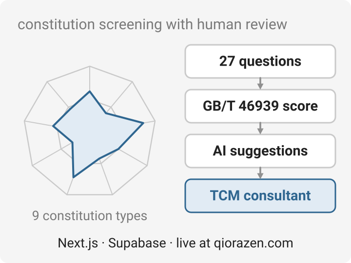

# Qiorazen

<p align="center">
  <picture>
    <source media="(prefers-color-scheme: dark)" srcset="docs/overview-dark.svg">
    
  </picture>
</p>

A wellness web app that pairs a **27-question constitution assessment** with Traditional Chinese
Medicine concepts. Answers are scored with the GB/T 46939-2025 standard into nine constitution
types; users can then submit questions, get AI-drafted diet, exercise and lifestyle suggestions,
and every suggestion is reviewed by a TCM consultant before it reaches them.

Live at **[qiorazen.com](https://qiorazen.com/)**.

## Stack

| Part | What it is |
|---|---|
| `apps/web` | Next.js 15 (App Router) — the deployed app, on Vercel |
| `packages/tcm-engine` | Pure-TypeScript scoring engine for the 27 questions and 9 types (Vitest) |
| `packages/db` | SQL migrations for Supabase Postgres with row-level security |
| `packages/types` | Shared TypeScript types |

Turborepo + pnpm workspaces.

## Develop

```bash
pnpm install
cp .env.example apps/web/.env.local   # Supabase, Stripe and Anthropic keys
pnpm dev                        # http://localhost:3000
pnpm --filter @qiorazen/tcm-engine test
pnpm --filter @qiorazen/web typecheck
```

Pushes to `main` deploy on Vercel. See [`DEPLOY_GUIDE.md`](DEPLOY_GUIDE.md) for setup,
[`GBT_46939_2025_REPORT.md`](GBT_46939_2025_REPORT.md) for the scoring standard and
[`LEGAL_RISK_FRAMEWORK.md`](LEGAL_RISK_FRAMEWORK.md) for how the service stays on the wellness side
of medical advice.
