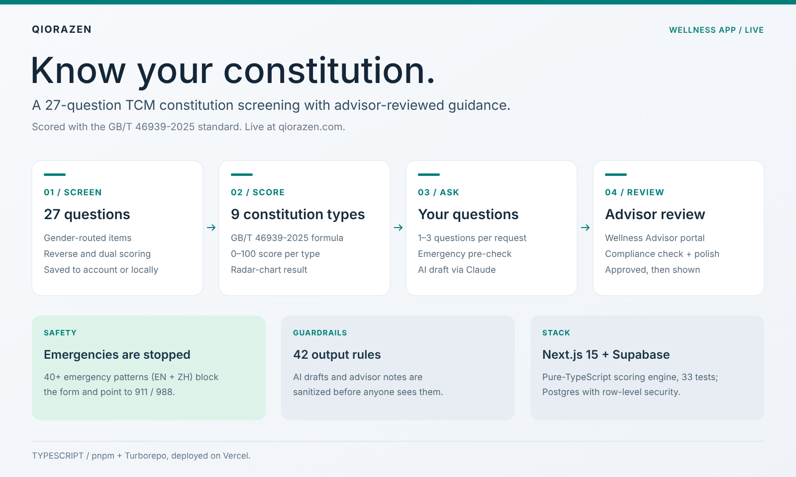

<div align="center">

# Qiorazen

**A 27-question TCM constitution screening with advisor-reviewed wellness guidance.**


[](https://qiorazen.com/)
[](https://www.ccao2679.com/projects/#qiorazen)



</div>

<!-- problem-framing:start -->

## Problem and evidence

> **Can an AI-assisted wellness drafting workflow produce reviewable, source-consistent text while enforcing access controls and keeping publication subject to human approval?**

**Why it matters:** Fluent generated text can overstate what questionnaire answers support. Users and reviewers need a traceable separation between input, draft, review and released content.

**Central tension:** Personalization encourages specific language, while limited evidence requires restraint. Pattern-based sanitization can catch known phrases but cannot by itself establish factual or medical validity.

[Full problem and verification plan](PROBLEM.md)

<!-- problem-framing:end -->

## Highlights

- **Screening:** 27 questions scored with the GB/T 46939-2025 standard into nine constitution types (0–100 each), shown as a radar chart.
- **Guidance with review:** users submit 1–3 questions; Claude drafts wellness guidance, and a Wellness Advisor checks and approves it before the user sees it.
- **Safety by default:** an emergency pre-check (40+ patterns, English and Chinese) blocks the form and points to 911 / 988; 42 guardrail rules sanitize every AI draft and advisor note.

## Stack

| Part | What it is |
|---|---|
| `apps/web` | Next.js 15 (App Router) — the deployed app, on Vercel |
| `packages/tcm-engine` | Pure-TypeScript scoring engine for the 27 questions and nine types (33 Vitest tests) |
| `packages/db` | SQL migrations for Supabase Postgres with row-level security |
| `packages/types` | Shared TypeScript types |

Turborepo + pnpm workspaces; Stripe for payments (mocked when no key is set).

## Develop

```bash
pnpm install
cp .env.example apps/web/.env.local   # Supabase, Stripe and Anthropic keys
pnpm dev                              # http://localhost:3000
pnpm --filter @qiorazen/tcm-engine test
pnpm --filter @qiorazen/web typecheck
```

Pushes to `main` deploy on Vercel. See [`DEPLOY_GUIDE.md`](DEPLOY_GUIDE.md) for setup,
[`GBT_46939_2025_REPORT.md`](GBT_46939_2025_REPORT.md) for the scoring standard and
[`LEGAL_RISK_FRAMEWORK.md`](LEGAL_RISK_FRAMEWORK.md) for how the service stays on the wellness side.
