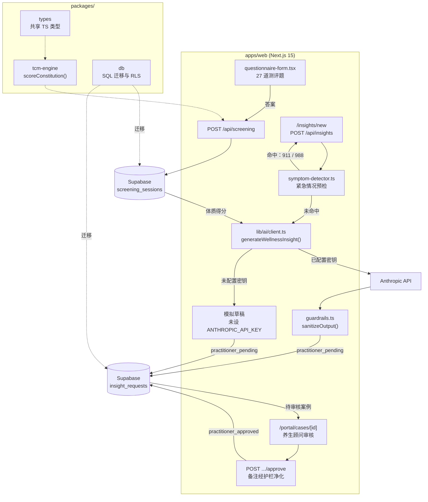

<div align="center">

# Qiorazen

[English](README.md) · **简体中文**

**27 道题的中医体质辨识，配以养生顾问审核把关的养生建议。**


[](https://qiorazen.com/)
[](https://www.ccao2679.com/projects/#qiorazen)


</div>

<!-- problem-framing:start -->

## 问题与依据

> **由 AI 辅助起草养生内容的工作流，能否在落实访问控制、且发布始终以人工批准为前提的同时，产出可审核、与输入来源一致的文本？**

**为什么值得解决：** 流畅的生成文本很容易夸大问卷答案实际能支持的结论。用户和审核人员需要在输入、草稿、审核和最终发布内容之间有清晰、可追溯的区分。

**核心矛盾：** 个性化会让措辞趋于具体，而有限的依据又要求措辞克制。基于模式匹配的内容净化能拦下已知的说法，但单靠它无法证明内容在事实或医学上成立。

[完整问题与验证方案](PROBLEM.zh.md)

<!-- problem-framing:end -->

## 亮点

- **体质测评：** 27 道题按 GB/T 46939-2025 标准计分，得出九种体质各自的得分（0–100），并以雷达图呈现。
- **建议经人工审核：** 用户提交 1–3 个问题，由 Claude 起草养生建议，养生顾问（Wellness Advisor）检查并批准后，用户才会看到。
- **默认安全：** 紧急情况预检（40+ 条中英文规则）会拦截表单，并引导拨打 911 / 988；42 条护栏规则会对每一份 AI 草稿和顾问备注做净化处理。

## 架构



虚线表示各 workspace 包提供的能力；实线是一次请求的完整路径：从 27 道题的测评表单，到经养生顾问批准的养生建议。未配置 `ANTHROPIC_API_KEY` 时，`lib/ai/client.ts` 不调用 Anthropic API，而是返回一份固定的模拟草稿；无论哪种情况，草稿都会以 `practitioner_pending` 状态写入 `insight_requests`，直到养生顾问批准。

## 技术栈

| 部分 | 说明 |
|---|---|
| `apps/web` | Next.js 15（App Router），即部署在 Vercel 上的应用 |
| `packages/tcm-engine` | 纯 TypeScript 计分引擎，覆盖 27 道题与九种体质（33 个 Vitest 测试） |
| `packages/db` | Supabase Postgres 的 SQL 迁移，启用行级安全（RLS） |
| `packages/types` | 共享的 TypeScript 类型 |

Turborepo + pnpm workspaces；支付使用 Stripe（未设置密钥时走模拟流程）。

## 本地开发

```bash
pnpm install
cp .env.example apps/web/.env.local   # Supabase, Stripe and Anthropic keys
pnpm dev                              # http://localhost:3000
pnpm --filter @qiorazen/tcm-engine test
pnpm --filter @qiorazen/web typecheck
```

推送到 `main` 后由 Vercel 自动部署。部署配置见 [`DEPLOY_GUIDE.md`](DEPLOY_GUIDE.md)，计分标准见 [`GBT_46939_2025_REPORT.md`](GBT_46939_2025_REPORT.md)，服务如何始终保持在养生而非医疗范畴内，见 [`LEGAL_RISK_FRAMEWORK.md`](LEGAL_RISK_FRAMEWORK.md)。
